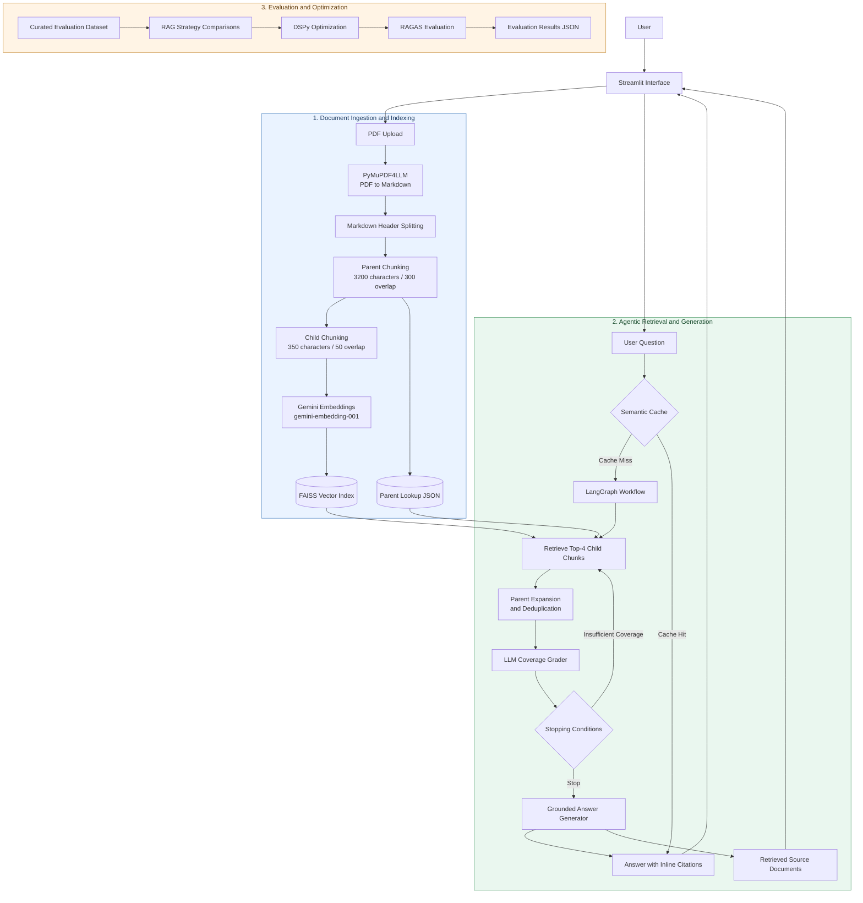
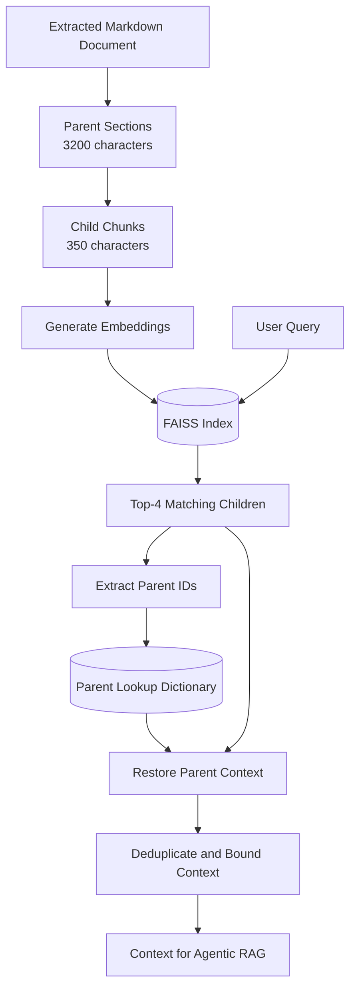
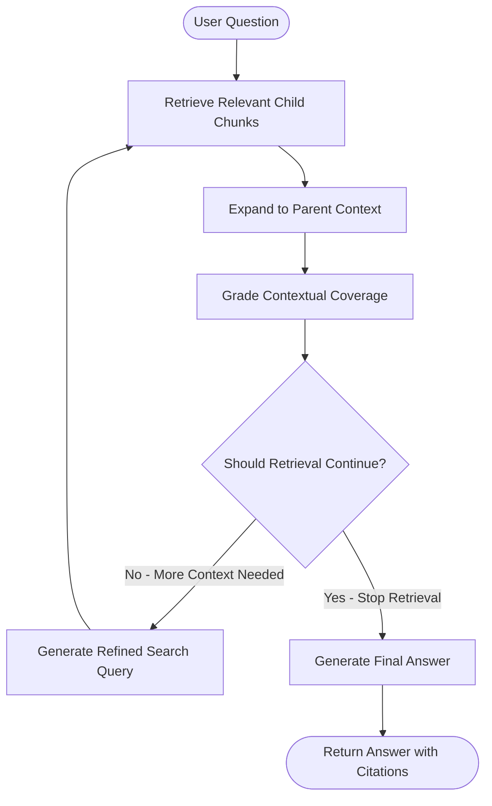
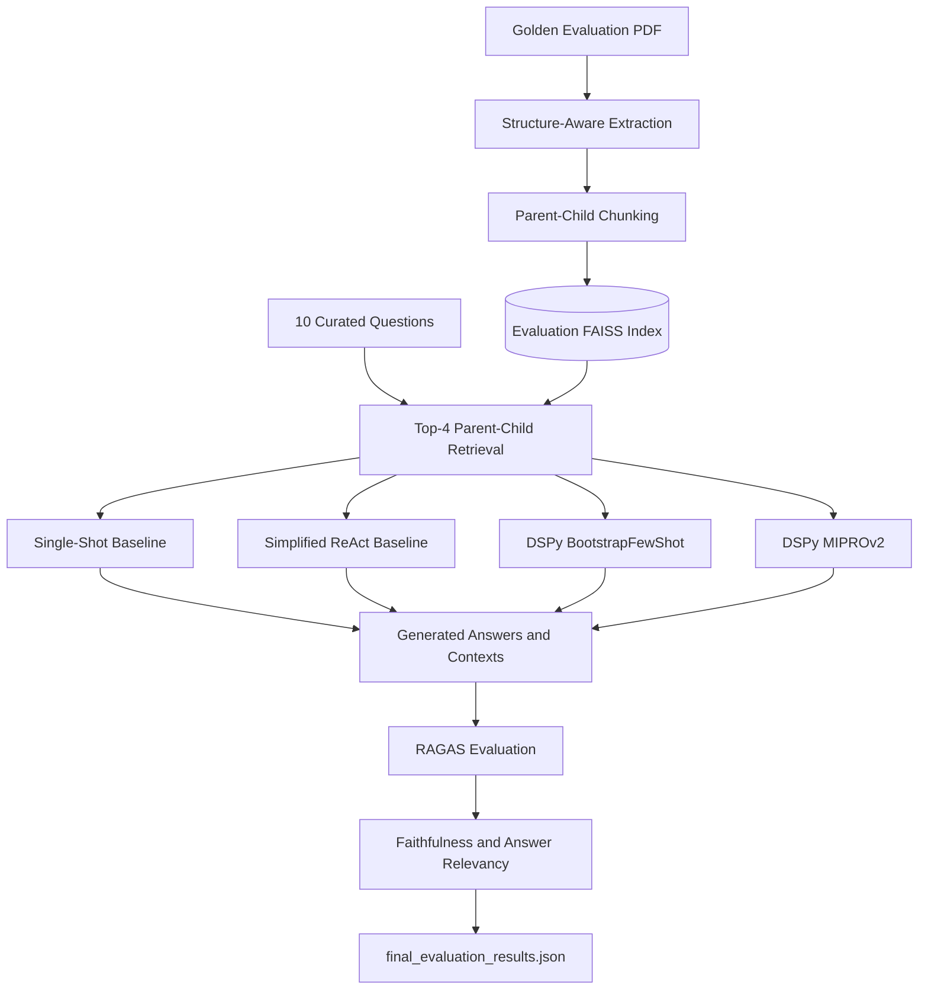

# Agentic RAG System

An intelligent, document-grounded question-answering system built around **Agentic Retrieval-Augmented Generation (RAG)**. It enables users to upload PDF documents and ask natural-language questions while combining structure-aware document processing, hierarchical Parent–Child Retrieval, semantic caching, and an adaptive retrieval loop to improve answer relevance and contextual coverage.

Unlike conventional single-pass RAG pipelines, this system uses **LangGraph to orchestrate an iterative Retrieve–Grade–Generate workflow**. It evaluates the retrieved context, identifies missing information, refines search queries, and retrieves additional context until predefined stopping conditions are satisfied.

The system uses **Google Gemini embeddings, FAISS, LangChain, LangGraph, Groq-hosted LLMs, and Streamlit** for document ingestion, vector retrieval, orchestration, and interactive question answering. A separate evaluation pipeline uses **RAGAS and DSPy** to compare retrieval and generation strategies.

---

## Features

- **PDF-Based Question Answering:** Upload PDF documents and interact with their contents using natural language.
- **Structure-Aware Document Extraction:** Converts PDFs into Markdown using PyMuPDF4LLM, preserving document structure and headings for more meaningful segmentation.
- **Hierarchical Parent–Child Chunking:** Splits documents into larger parent sections and smaller child chunks to balance retrieval precision with contextual completeness.
- **Semantic Vector Search:** Generates embeddings using Google's Gemini Embedding model and indexes child chunks using FAISS.
- **Parent–Child Retrieval:** Searches smaller child chunks for precise matching, then expands relevant matches into their associated parent sections to provide richer context.
- **Agentic Iterative Retrieval:** Uses LangGraph to orchestrate multiple retrieval and grading iterations rather than relying exclusively on a single retrieval pass.
- **LLM-Based Coverage Grading:** Evaluates how much of the original question can be answered using the accumulated context.
- **Intelligent Query Refinement:** Generates targeted follow-up search queries when the retrieved context does not sufficiently cover the question.
- **Adaptive Stopping Conditions:** Avoids unnecessary retrieval iterations through coverage thresholds, retrieval exhaustion detection, stagnation detection, repeated-query detection, and a context token-budget backstop.
- **Source-Grounded Answer Generation:** Instructs the generator to answer exclusively from retrieved document context, cite supporting sources inline, and acknowledge missing information.
- **Inline Source Citations:** Generates `[Source N]` references and provides access to the corresponding retrieved source documents.
- **Semantic Answer Cache:** Uses embedding-based similarity matching to return previously generated answers for sufficiently similar questions.
- **Persistent Vector Storage:** Saves and restores FAISS indexes locally, avoiding unnecessary document reprocessing across application restarts.
- **Quota-Aware Embedding and Evaluation:** Processes embedding and evaluation workloads in controlled batches with configurable delays.
- **RAG Evaluation Framework:** Compares Single-Shot RAG, simplified ReAct retrieval, BootstrapFewShot, and MIPROv2-based generation configurations.
- **Automated Evaluation Metrics:** Uses RAGAS Faithfulness and Answer Relevancy to assess generated answers.
- **Interactive Retrieval Transparency:** Exposes retrieval iterations, coverage history, issued queries, and retrieved source documents through the Streamlit interface.

---

## System Architecture

The system is organized into three principal stages:

1. **Document Ingestion and Indexing** – Converts uploaded PDFs into structured, hierarchical document chunks and builds a persistent vector index.
2. **Agentic Retrieval and Generation** – Uses semantic caching and a LangGraph-controlled retrieval loop to collect, evaluate, and generate answers from relevant document context.
3. **Evaluation and Optimization** – Uses a separate experimental pipeline to compare RAG strategies and evaluate generation quality.

### High-Level Architecture



### 1. Document Ingestion and Structure-Aware Processing

The ingestion pipeline converts uploaded PDF documents into structured Markdown before generating embeddings.

Instead of treating the entire document as unstructured plain text, the system preserves its hierarchical organization using document headings.

**Processing workflow:**

1. A PDF is uploaded through the Streamlit interface.
2. PyMuPDF4LLM extracts the document and converts it into Markdown.
3. MarkdownHeaderTextSplitter identifies sections using four heading levels: H1, H2, H3, and H4.
4. RecursiveCharacterTextSplitter creates bounded parent chunks.
5. Each parent chunk is further divided into smaller child chunks.
6. Child chunks are embedded using Google's Gemini Embedding model.
7. Embeddings are stored in a FAISS vector index.
8. Parent content is persisted separately in a JSON lookup dictionary.

This approach retains structural context while allowing the vector database to operate on smaller, more targeted text segments.

### 2. Hierarchical Parent–Child Retrieval

One of the core architectural decisions is the use of **Parent–Child Retrieval**.

Conventional chunk-based retrieval can introduce two problems:

- Large chunks may contain too much irrelevant text, reducing retrieval precision.
- Small chunks may match a question accurately but lack enough surrounding context to support a complete answer.

Parent–Child Retrieval addresses this trade-off by separating the retrieval unit from the context supplied to the LLM.

**Current chunking configuration:**

| Parameter | Configuration |
|---|---:|
| Parent chunk size | 3,200 characters |
| Parent chunk overlap | 300 characters |
| Child chunk size | 350 characters |
| Child chunk overlap | 50 characters |
| Retriever top-K | 4 |
| Maximum expanded parent content | 3,500 characters per parent |

**Retrieval workflow:**

1. The vector retriever searches the child chunks using semantic similarity.
2. The four most relevant child chunks are retrieved.
3. Each child's `parent_id` is used to identify its corresponding parent section.
4. The original parent content is loaded from the parent lookup dictionary.
5. Parent content is bounded to a maximum of 3,500 characters.
6. Duplicate parents and already accumulated context are removed.
7. The resulting parent sections become the context for coverage grading and answer generation.



**Why this architecture?**

- Smaller child chunks improve the granularity of semantic matching.
- Larger parent chunks preserve surrounding information and document structure.
- Parent identifiers maintain the relationship between retrieved matches and their original context.
- Deduplication reduces repeated information in the LLM context.
- Bounded parent expansion helps control context size.

### 3. Agentic Retrieval Using LangGraph

The central component of the system is a LangGraph StateGraph implementing an iterative **Retrieve–Grade–Generate** workflow.

A conventional RAG pipeline typically retrieves a fixed number of documents and immediately generates an answer. This implementation introduces an additional evaluation stage before generation.

The grader estimates how much of the original question is answerable from the retrieved context. When information is missing, it produces a more targeted search query, allowing the system to retrieve additional document sections.

#### Workflow Nodes

| Node | Responsibility |
|---|---|
| Retrieve | Searches the FAISS child index, expands matching children into parent context, and accumulates unique documents. |
| Grade | Evaluates contextual coverage and generates a refined query when additional information is required. |
| Generate | Produces the final answer using only the accumulated retrieved context, with inline source citations. |

The graph is initialized with the Retrieve node and follows conditional transitions between Grade, Retrieve, and Generate.

#### Agentic Retrieval Flow



#### Adaptive Retrieval Termination

To prevent unnecessary LLM calls and unproductive retrieval cycles, the workflow implements multiple termination signals.

| Termination Signal | Condition | Purpose |
|---|---|---|
| Coverage threshold | Coverage ≥ 0.95 | Stops when the grader estimates that at least 95% of the question is covered. |
| Retrieval exhaustion | No new unique parent context is retrieved | Stops when further retrieval does not contribute new information. |
| Coverage stagnation | Latest coverage ≤ previous coverage + 0.02 | Stops when another retrieval iteration produces negligible improvement. |
| Query stagnation | A refined query has already been issued | Prevents repeatedly searching with an earlier query. |
| Context token budget | Estimated accumulated context tokens ≥ 6,000 | Limits further retrieval when the context budget is reached. |

These conditions allow the system to adapt retrieval effort to the question instead of always executing the same fixed number of retrieval calls.

The accumulated context is also bounded to 16,000 characters when supplied to the grader and generator.

### 4. Grounded Answer Generation and Source Attribution

Once the retrieval workflow terminates, the generator receives:

- The original user question.
- The accumulated parent-level document context.
- The latest coverage estimate.

The generator is instructed to follow a strict context-grounded answering policy.

**Generation principles:**

- Answer directly and avoid unnecessary introductory text.
- Use only the supplied document context.
- Attach inline `[Source N]` references to supporting claims.
- Answer the portions of multi-part questions that are supported by the retrieved context.
- Explicitly identify information that is missing from the document.
- Never invent facts, numerical values, or source references.
- Return the specified fallback response when the context does not contain the answer.

The application also provides a source-document expander. It extracts source references from the generated answer and displays the corresponding retrieved documents.

This makes the answer-generation process more transparent and allows users to inspect the context behind the generated response.

### 5. Semantic Caching

The system implements an embedding-based semantic cache to avoid repeatedly generating answers for semantically similar questions.

Unlike a conventional exact-string cache, semantic caching compares the meaning of a new query against previously stored query embeddings.

**Cache workflow:**

1. Generate an embedding for the incoming question.
2. Search the semantic cache FAISS index for the nearest stored query.
3. Retrieve the nearest result using top-1 similarity search.
4. Compare its calculated similarity against the configured threshold of **0.90**.
5. Return the previously stored answer when the threshold is satisfied.
6. Otherwise, execute the complete agentic retrieval workflow.
7. Store the new question and generated answer in the semantic cache.

The cache is persisted locally and cleared when a new PDF is processed through the ingestion path.

**Benefits:**

- Avoids repeated retrieval and generation for sufficiently similar questions.
- Reduces redundant LLM calls.
- Improves response time for cache hits.
- Reuses previously generated answers without rebuilding the document vector index.

### 6. LLM Architecture and Model Separation

The implementation separates embedding generation, contextual grading, answer generation, evaluation judging, and prompt optimization into dedicated model roles.

| Component | Model / Provider | Responsibility |
|---|---|---|
| Embedding Model | Google Gemini – `gemini-embedding-001` | Document and query embeddings |
| Coverage Grader | Groq – `llama-3.3-70b-versatile` | Contextual coverage estimation and query refinement |
| Answer Generator | Groq – `openai/gpt-oss-120b` | Context-grounded answer generation |
| Evaluation Judge | Google Gemini – `gemini-3.8-flash` | RAGAS evaluation |
| DSPy Optimization LLM | Groq – `qwen/qwen3.8-27b` | Prompt optimization experiments |

The grader and answer generator are configured as separate LLM instances with temperature set to 0.0.

This separation provides clearer responsibility boundaries between retrieval evaluation and final answer generation.

---

## Performance Optimizations and Engineering Decisions

The system incorporates several optimizations intended to reduce unnecessary computation, control context size, and improve retrieval efficiency.

### 1. Parent–Child Chunking

Uses small child chunks for similarity search and larger parent chunks for context reconstruction.

This balances retrieval precision with the contextual information required for reliable answer generation.

### 2. Context Deduplication

Retrieved parent sections are accumulated across iterations, but duplicate content is excluded.

This prevents the same document section from unnecessarily occupying the context window multiple times.

### 3. Bounded Context Expansion

Each expanded parent section is capped at 3,500 characters, while the grader and generator receive a context capped at 16,000 characters.

This provides explicit bounds on context growth.

### 4. Adaptive Retrieval Instead of Fixed Retrieval

The iterative graph continues retrieving only when the coverage grader determines that additional context may be useful.

The stopping conditions prevent wasted iterations when coverage is sufficient, retrieval is exhausted, or progress has stagnated.

### 5. Semantic Cache Reuse

Previously generated answers can be reused for sufficiently similar questions, avoiding repeated execution of the full RAG pipeline.

### 6. Batched Embedding Generation

Document embeddings are generated in batches of 80 child chunks.

The ingestion implementation introduces a 60-second delay between batches when additional batches remain, providing a configurable mechanism for pacing embedding requests.

### 7. Persistent Vector Indexes

The document index, semantic cache, and evaluation index are persisted locally.

This reduces redundant embedding work across application restarts, provided the corresponding index files and metadata remain available.

### 8. Persistent Parent Lookup

Parent-level document content is stored independently in JSON files, allowing the retrieval component to reconstruct the original parent context without indexing the larger chunks directly.

### 9. Controlled Evaluation Execution

The evaluation pipeline processes RAGAS samples in batches of two, uses a single evaluation worker, and introduces configurable delays between model requests.

This is intended to keep evaluation execution within the configured model rate limits.

---

## Evaluation Framework: RAGAS + DSPy

The project includes a separate evaluation pipeline designed to compare different RAG strategies rather than relying exclusively on subjective answer inspection.

The evaluation script uses a manually curated **10-question Golden Evaluation Dataset**, organized into three difficulty levels:

| Question Category | Number of Questions | Purpose |
|---|---:|---|
| Simple | 3 | Tests direct factual retrieval |
| Moderate | 3 | Tests contextual understanding and more involved retrieval |
| Complex Multi-Hop | 4 | Tests combining information across multiple document sections |

The evaluation dataset contains reference answers and is used to compare different retrieval and generation configurations.

### Evaluation Architecture



### 1. Single-Shot RAG Baseline

The baseline represents a conventional RAG workflow:

1. Retrieve the top four relevant child chunks.
2. Expand them into parent-level context.
3. Supply the context and original question to the generator.
4. Generate an answer in a single generation call.

This provides a reference point for evaluating the benefits of more advanced retrieval and prompt configurations.

### 2. Simplified ReAct-Style Retrieval Baseline

This experimental configuration introduces an additional contextual assessment step.

1. Retrieve relevant parent context.
2. Ask the grader whether the context is sufficient to answer the question.
3. If the grader responds negatively, generate one refined query.
4. Retrieve additional context using the refined query.
5. Generate the final answer.

Unlike the primary LangGraph implementation, this evaluation baseline performs at most one additional refinement retrieval.

### 3. DSPy BootstrapFewShot

The evaluation pipeline also experiments with DSPy's BootstrapFewShot optimizer.

A dedicated DSPy signature defines the question, context, and answer fields, while a custom metric measures lexical token recall against the reference answer.

The current experiment configures both bootstrapped and labeled demonstrations to zero. Consequently, this is an experimental optimizer configuration rather than a few-shot demonstration-based production pipeline.

### 4. DSPy MIPROv2

MIPROv2 is included as another prompt-optimization experiment.

The current configuration uses:

- Two candidate instructions.
- One optimization trial.
- One optimization thread.
- No bootstrapped demonstrations.
- No labeled demonstrations.
- Disabled minibatch optimization.

The optimized configuration is evaluated using the same Golden Evaluation Dataset.

Both DSPy configurations are saved separately for subsequent inspection or reuse.

### 5. RAGAS Evaluation Metrics

All four answer-generation configurations are evaluated with RAGAS.

| Metric | What It Evaluates |
|---|---|
| Faithfulness | Whether the generated answer is supported by the retrieved context |
| Answer Relevancy | Whether the generated answer appropriately addresses the user's question |

The evaluation uses a separate Gemini-based judge and Gemini embeddings for answer relevancy.

The custom DSPy optimization metric also calculates token-level recall against the reference answer, with a 0.35 threshold used for its trace-based acceptance decision.

### Evaluation Outputs

The evaluation pipeline compares:

- Single-Shot
- ReAct
- BootstrapFewShot
- MIPROv2

The aggregated metric results are saved to:

- `final_evaluation_results.json`
- `optimized_bfs.json`
- `optimized_mipro.json`

The resulting JSON comparison contains the Faithfulness and Answer Relevancy scores for each evaluated configuration.

*Actual benchmark scores are intentionally not listed here because the evaluation output file containing measured results was not included among the supplied project files.*

---

## Technology Stack

| Technology | Purpose |
|---|---|
| Python | Core application and evaluation logic |
| Streamlit | Interactive user interface |
| LangChain | Document processing, embeddings, retrievers, and LLM integrations |
| LangGraph | Stateful orchestration of the agentic retrieval workflow |
| PyMuPDF4LLM | Structure-aware PDF-to-Markdown conversion |
| RecursiveCharacterTextSplitter | Parent and child chunk generation |
| MarkdownHeaderTextSplitter | Hierarchical Markdown section splitting |
| Google Gemini Embeddings | Semantic vector representations |
| Groq | Hosted coverage-grading and answer-generation LLMs |
| FAISS | Vector similarity search and persistent indexes |
| RAGAS | Faithfulness and Answer Relevancy evaluation |
| DSPy | Experimental prompt optimization |
| Pandas | Aggregation and reporting of evaluation results |
| Python-dotenv | Environment-based configuration management |

---

## Project Structure

The following represents the principal source files and the runtime artifacts referenced or generated by the current implementation.

```text
Agentic-RAG-System/
│
├── chatbot.py
│   └── Streamlit application, document ingestion,
│       hierarchical retrieval, semantic cache,
│       LangGraph workflow, and answer generation
│
├── eval_pipeline.py
│   └── Golden Dataset evaluation, baseline comparisons,
│       DSPy optimization, and RAGAS metric reporting
│
├── data/
│   └── eval_document.pdf
│       └── Evaluation document referenced by the
│           evaluation pipeline
│
├── faiss_index/
│   └── Persisted document vector index
│
├── semantic_cache/
│   └── Persisted semantic question-answer cache
│
├── faiss_index_eval/
│   └── Persisted evaluation vector index
│
├── parent_lookup.json
│   └── Parent document lookup for the main RAG pipeline
│
├── parent_lookup_eval.json
│   └── Parent document lookup for evaluation
│
├── processed_file.txt
│   └── Name of the processed PDF document
│
├── optimized_bfs.json
│   └── Saved DSPy BootstrapFewShot configuration
│
├── optimized_mipro.json
│   └── Saved DSPy MIPROv2 configuration
│
└── final_evaluation_results.json
    └── Aggregated RAGAS evaluation results
```

*The evaluation PDF is an input referenced by `eval_pipeline.py`; it was not included in the supplied source files. The index, lookup, and result files are runtime artifacts and need not all be committed to version control.*

---

## Design Considerations and Limitations

A few implementation details are important when interpreting the current architecture.

- **Document Scope:** The current application maintains one active document vector index rather than a multi-tenant, multi-document knowledge base.
- **Local Persistence:** FAISS indexes and parent lookup dictionaries are persisted as local files. Distributed storage and multi-instance synchronization are not implemented.
- **Semantic Cache Matching:** The cache uses an embedding similarity threshold of 0.90. Its distance-to-similarity conversion assumes normalized vectors and the expected FAISS L2-distance behavior.
- **Document Identity:** The processed-document check is based on the uploaded filename. Replacing a PDF with different content under the same filename may not trigger reprocessing.
- **Citation Reliability:** Inline citations are generated through LLM instructions and extracted from the generated answer. They should be validated against source identifiers before being treated as a production-grade citation system.
- **Coverage Grading:** Coverage is an LLM-generated estimate, not an independently measured retrieval-recall score.
- **Grader Error Handling:** If the grader's JSON response cannot be parsed, the current implementation defaults the coverage estimate to 1.0 and proceeds towards generation. A stricter production implementation should treat grading failures separately.
- **Index Deserialization:** FAISS loading uses dangerous deserialization. Persisted index files should therefore only be loaded from trusted sources.
- **Evaluation Scope:** The current evaluation uses a manually curated 10-question dataset. Larger and more diverse datasets would be needed to establish broader performance claims.

### Potential Production Extensions

The existing architecture provides a foundation for further improvements, including:

- Content-hash-based document identity and reliable index invalidation.
- Multi-document collections with document-level metadata filtering.
- Hybrid keyword and vector retrieval.
- Cross-encoder or LLM-based reranking.
- Page-level citations and deterministic source tracking.
- More robust API retries, timeout handling, and malformed-response recovery.
- User authentication, authorization, and document isolation.
- Centralized persistence and observability for production deployments.
- Expanded evaluation datasets with retrieval-specific metrics and regression testing.

These are potential extensions, not features claimed by the current implementation.

---

## Notes

- The answer-generation workflow is designed to remain grounded in the uploaded document rather than relying on the model's general knowledge.
- The iterative retrieval mechanism is intended to improve contextual coverage for questions requiring information from multiple document sections.
- The semantic cache, bounded parent expansion, and adaptive stopping conditions help reduce unnecessary processing.
- The evaluation pipeline provides a repeatable starting point for comparing different RAG and prompt-optimization strategies.
- API credentials should be managed through environment variables and should never be hardcoded or committed to version control.
- Only trusted FAISS index files should be loaded because the implementation enables pickle-based deserialization.

---

## Future Direction

The focus is on improving retrieval quality, reducing unnecessary LLM calls, strengthening answer attribution, and introducing measurable evaluation improvements rather than simply increasing model complexity.

**Core architectural principle: Retrieve precisely, evaluate context continuously, generate only from supporting evidence, and measure improvements through repeatable evaluation.**
